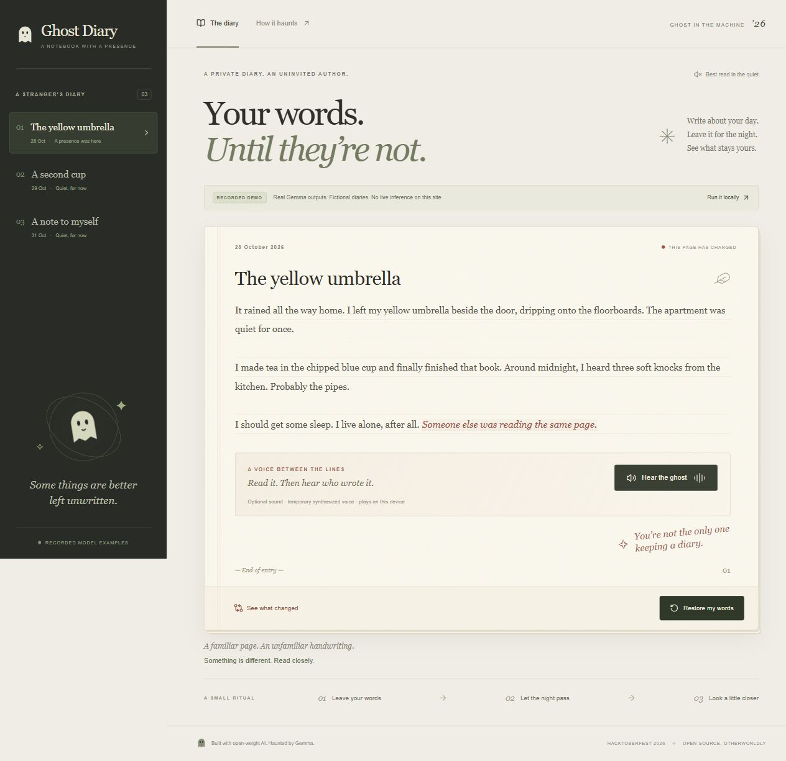
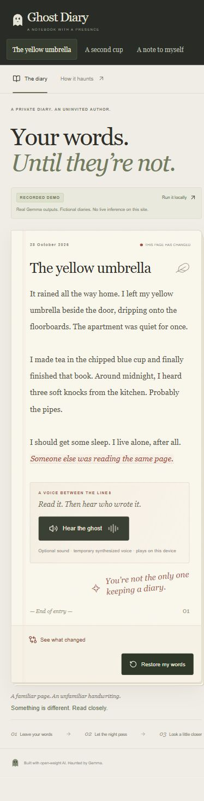
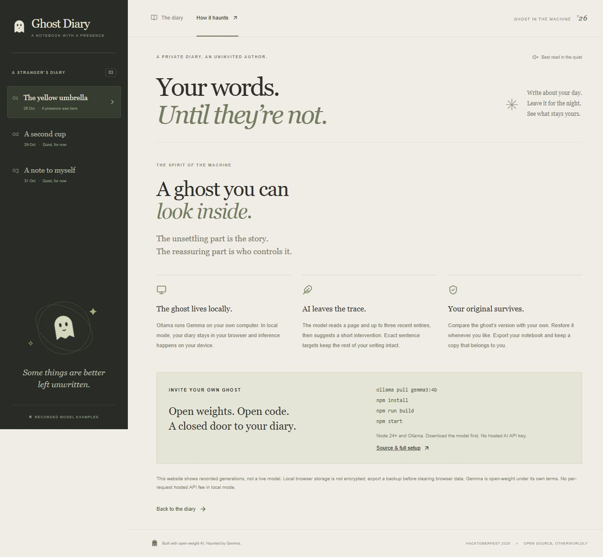

# Ghost Diary

**Your words. Until they're not.**

A private notebook with an uninvited author. Write about your day, pass the night, and discover a sentence you never wrote. Gemma reads your entry and a little of its history, then leaves a trace in the margins of your life.

Built for [Hacktoberfest Open-Source AI Challenge Week 4: Ghost in the Machine](https://dev.to/challenges/hacktoberfest-week4-2026-10-26).

## Two experiences, clearly separated

- **Local app:** write your own diary, generate real interventions using Ollama + Gemma, compare with your original, restore, and export/import a backup.
- **Recorded website:** explore three fictional diary pages, reveal genuine Gemma outputs with a short ink animation, and optionally hear the added sentence. It has no live inference or personal diary editor. The diary banner and explanatory page identify it as recorded.

Source: [github.com/style96/ghost-diary](https://github.com/style96/ghost-diary).
Public recorded demo: [ghostinthemachine.tech](https://ghostinthemachine.tech). DNS routing and HTTPS are active; details are in [deployment notes](docs/deployment.md).



*Public deployment screenshots show an earlier fixture. The new fictional pages and genuine Gemma callbacks were deployed on 2026-10-31; see the deployment notes for version provenance.*

[Watch the 90-second English demo](deliverables/ghost-diary-demo.mp4) · [English captions](deliverables/ghost-diary-demo.en.srt) · [Editable video source](deliverables/ghost-diary-video-source.zip)

## Hear the ghost and watch the ink appear

Select **Pass the night** to reveal the intervention. New words appear over about **1.2 seconds**; reduced-motion preferences show them immediately. Existing pages and the comparison view do not replay the animation.

In the recorded demo, **Hear the ghost** plays the added sentence only when the voice manifest matches it exactly. The current three examples have matching ElevenLabs soft-whisper recordings. In the local Windows app, the same button generates the current ghost insertion using the original Windows desktop speech pipeline. Sound never autoplays. **Stop the ghost** rewinds audio; restoring the page, editing, switching entries or opening **How it haunts** stops playback too.

**Gemma generates the text, not the audio.** The recorded demo bundles ElevenLabs Sarah soft-whisper MP3s. The local app reuses the pre-ElevenLabs Windows default desktop voice, rate -1 and volume 90, with the existing slowdown, filter and quiet delayed layers. There is no background soundtrack or new sound design. Local speech needs Windows desktop speech and Python 3, sends only the ghost insertion to the loopback server after a click, and makes no external speech API request. Its temporary files are removed after generation; the browser releases generated audio on navigation or cancellation. Other platforms can still use the text diary, but this speech path is Windows-only.

Audio files, provenance and regeneration: [audio README](public/audio/README.md). The [voice manifest](src/demo/voices.json) must match the exact spoken sentence; stale audio is hidden after demo text changes. Personal entries use newly generated local audio, never unrelated demo recordings.

<details>
<summary>Mobile recorded demo</summary>



</details>

<details>
<summary>How it haunts</summary>



</details>

## Run the real local app

Requires Node.js **24+**, npm and [Ollama](https://ollama.com/download). Download the dependencies and weights while online:

```sh
git clone https://github.com/style96/ghost-diary.git
cd ghost-diary
ollama pull gemma3:4b
npm install
npm run build
npm start
```

Open **http://127.0.0.1:3001**. Keep Ollama running. Write a page, save it, then select **Pass the night**. Use **See what changed** to compare, or **Restore my words** to remove the ghost's active trace.

The app asks the model to make one short intervention. It uses exact, unique sentence targets to protect the rest of your writing. Invalid edits fail visibly rather than replacing your diary with a canned response. A fresh request may produce a different result; this is generative fiction.

### Other models and development

Default tested model: [`gemma3:4b`](https://ollama.com/library/gemma3:4b). A `gemma3:1b` probe ran successfully but produced weaker prose. Hardware affects speed and model feasibility. To choose an installed compatible model:

```powershell
# PowerShell
$env:GHOST_MODEL = 'gemma3:1b'
npm start
```

```sh
# macOS / Linux
GHOST_MODEL=gemma3:1b npm start
```

To develop, run `npm run dev:server` and `npm run dev` in separate terminals. Vite proxies `/api` to the local server. Use the exact printed `127.0.0.1` address; storage is separate for different origins, including `localhost`, ports and protocols.

## Build the public recorded website

```sh
npm run build:demo
npx vite preview --host 127.0.0.1 --port 4173 --outDir out
```

Deploy `out/` to static hosting. `npm run build` produces the **local** UI in `dist/`; do not deploy that as if it provides hosted inference.

`npm run record:demo -- --candidates 3` makes three real local calls per fictional page and checkpoints every candidate (including failures) in ignored `artifacts/demo-candidates.json`. It leaves the demo unchanged until you review the candidates and run `npm run record:demo -- --select 1,2,3` with one chosen attempt per page. Selection checks that edits match the raw reply, validates their application and writes `src/demo/recorded.json`, `docs/demo-generation.json` and `docs/model-measurements.json`. Never edit a model sentence and present it as recorded output. Use fictional inputs only: these evidence files deliberately retain the complete supplied context.

The [callback evidence](docs/history-callbacks.md) explains the selected examples, rejected exploratory rounds and measured durations. Exact prompts, prior originals, raw Ollama replies, model digest and timings are saved in the repository for review. These are curated examples, not a guarantee that every fresh live generation will have the same quality.

## How the ghost works

```text
Browser diary (IndexedDB)
    → loopback Node server (:3001)
    → loopback Ollama (:11434) → Gemma
    → schema + exact-target validation
    → store ghost version alongside original
```

- React, TypeScript and Vite render the notebook.
- IndexedDB stores entries, preserved originals, revisions and the active haunting.
- The model receives the current original and up to three recent original entries, within a 24,000-character context budget.
- [Ghost instructions](server/ollama.ts) are editable; no agent framework or external model API is required.
- Instructions ask for a small action involving a distinctive detail from actual history, naturally connected to today's sentence. With empty history, only today's details may establish the presence; invented earlier memories are forbidden. Instructions and JSON diary data share one user turn for compatibility with the installed Gemma template. Story fields are untrusted data.
- Structured JSON is checked again by application code: missing, repeated or overlapping anchors and oversized edits are rejected atomically.
- Entry revision checks stop late model responses from overwriting edits or resurrecting deleted entries.
- The local server binds to loopback, checks Host/Origin and limits bodies and concurrent generations. Do not expose it or Ollama to the internet.

## Privacy, offline use and ownership

In local mode, this app sends diary text only to the local Node server and local Ollama. No hosted model endpoint, third-party analytics, external fonts or API key is needed. Browser storage is **not encrypted** and is not a substitute for device security. Clearing browser data can erase your diary. Export a JSON backup and store it safely; backups contain plain text.

With dependencies, model weights and the production build already installed, the local experience does not need an internet connection.

The public website is separately hosted and uses fictional recorded fixtures. DevRelay, when connected, shares a curated **development transcript**, not your personal diary. No per-request hosted AI fee is required locally; hardware, electricity and domain renewal still have costs.

## Recorded ElevenLabs narration

The optional offline command `npm run record:voices` generates three MP3 clips
from the current fictional ghost insertions using the official ElevenLabs SDK.
Run `npx -y @elevenlabs/cli@latest onboard init` for account setup, then
`npm run record:voices:dry` to inspect the text without spending quota or loading credentials.
The command loads credentials from ignored `.env.local` in Node; browser playback
uses bundled audio and sends no request to ElevenLabs. Three real Sarah-voice
MP3s were generated on 2026-10-31 and now match the current demo insertions;
the older Windows WAV assets are retained but no longer referenced.
See [audio setup and generation](public/audio/README.md).

## Verification

```sh
npm test
npm run typecheck
npm run build
npm run build:demo
npm audit
```

Behavioral tests cover original preservation, literal Unicode/markup, missing/ambiguous/overlapping targets, stale responses, backup validation and the local request boundary. See [evidence](docs/evidence.md), [demo script](docs/demo-script.md) and [DEV draft](docs/submission.md).

## License and attribution

Original application code: [MIT](LICENSE). Gemma is **open-weight**, governed separately by the [Gemma Terms of Use](https://ai.google.dev/gemma/terms); its weights are not included in this repository. [Ollama](https://github.com/ollama/ollama) provides the local inference runtime. Interface icons are from [Lucide](https://lucide.dev/license). The original ghost illustration is inline SVG. Codex assisted development; the runtime diary AI is Gemma.

## Deadline and change record

The [contest rules](https://dev.to/challenges/hacktoberfest-week4-2026-10-26) give the cutoff as **October 31, 2026, 23:59 PDT** (**November 1, 2026, 07:59 Europe/Berlin**).

- **2026-10-31, before the deadline:** strengthened history callbacks and Gemma message packaging; recorded new fictional local `gemma3:4b` examples with complete candidate provenance; kept stale narration hidden; added regression tests and documentation. Committed and pushed as `ab97d3c`, then deployed as Sites version 3 on the user's subsequent request. New ElevenLabs work was excluded from this deployment.
- **Post-deadline changes:** none made in this task. Future changes or commits after the cutoff must be listed here with their actual dates and scope.
- **2026-10-31, before the deadline:** added approved ElevenLabs soft-whisper recordings for the three recorded examples, reused the original Windows speech pipeline for local entries, and produced a 90-second English narrated demo with captions and editable source. Verified 135 tests and both builds. This repository update does not deploy the hosted site.
