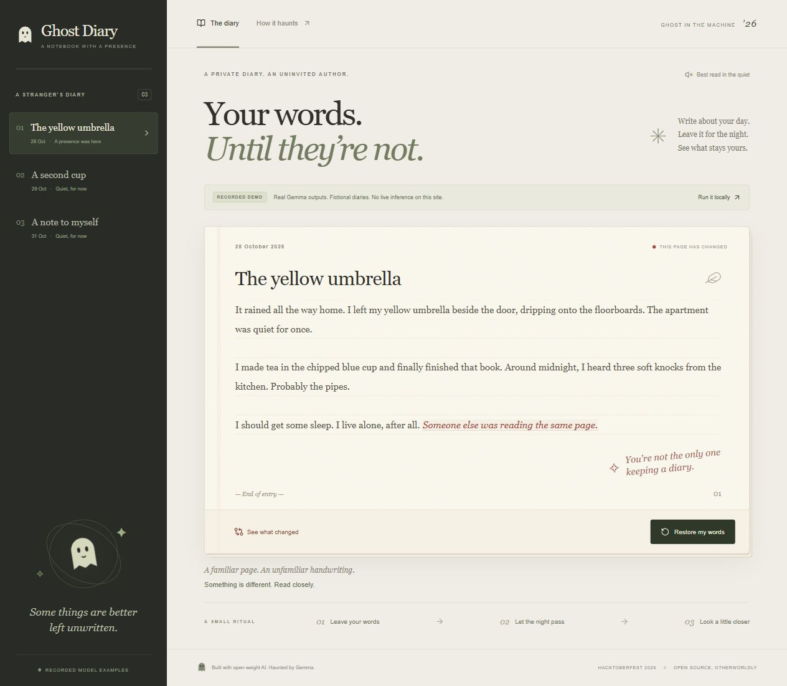

# Ghost Diary

**Your words. Until they're not.**

A private notebook with an uninvited author. Write about your day, pass the night, and discover a sentence you never wrote. Gemma reads your entry and a little of its history, then leaves a trace in the margins of your life.

Built for [Hacktoberfest Open-Source AI Challenge Week 4: Ghost in the Machine](https://dev.to/challenges/hacktoberfest-week4-2026-10-26).

## Two experiences, clearly separated

- **Local app:** write your own diary, generate real interventions using Ollama + Gemma, compare with your original, restore, and export/import a backup.
- **Recorded website:** explore three fictional diary pages and reveal genuine, previously generated Gemma outputs. It has no live inference or personal diary editor. The persistent banner identifies it as recorded.

Source: [github.com/style96/ghost-diary](https://github.com/style96/ghost-diary).
Public recorded demo: [ghostinthemachine.tech](https://ghostinthemachine.tech). DNS routing and HTTPS are active; details are in [deployment notes](docs/deployment.md).



## Run the real local app

Requires Node.js **24+**, npm and [Ollama](https://ollama.com/download). Download the dependencies and weights while online:

```sh
git clone https://github.com/style96/ghost-diary.git
cd ghost-diary
ollama pull gemma3:4b
npm install
npm run build
npm start
```

Open **http://127.0.0.1:3001**. Keep Ollama running. Write a page, save it, then select **Pass the night**. Use **See what changed** to compare, or **Restore my words** to remove the ghost's active trace.

The app asks the model to make one short intervention. It uses exact, unique sentence targets to protect the rest of your writing. Invalid edits fail visibly rather than replacing your diary with a canned response. A fresh request may produce a different result; this is generative fiction.

### Other models and development

Default tested model: [`gemma3:4b`](https://ollama.com/library/gemma3:4b). A `gemma3:1b` probe ran successfully but produced weaker prose. Hardware affects speed and model feasibility. To choose an installed compatible model:

```powershell
# PowerShell
$env:GHOST_MODEL = 'gemma3:1b'
npm start
```

```sh
# macOS / Linux
GHOST_MODEL=gemma3:1b npm start
```

To develop, run `npm run dev:server` and `npm run dev` in separate terminals. Vite proxies `/api` to the local server. Use the exact printed `127.0.0.1` address; storage is separate for different origins, including `localhost`, ports and protocols.

## Build the public recorded website

```sh
npm run build:demo
npx vite preview --host 127.0.0.1 --port 4173 --outDir out
```

Deploy `out/` to static hosting. `npm run build` produces the **local** UI in `dist/`; do not deploy that as if it provides hosted inference.

`npm run record:demo` calls your real local model three times and replaces `src/demo/recorded.json` with new fictional examples, including model and generation timestamps. It records duration measurements under ignored `artifacts/`. It does not manufacture responses. The committed examples took **5,528 ms, 7,171 ms and 7,998 ms** on the development machine; these are observations, not performance promises.

## How the ghost works

```text
Browser diary (IndexedDB)
    → loopback Node server (:3001)
    → loopback Ollama (:11434) → Gemma
    → schema + exact-target validation
    → store ghost version alongside original
```

- React, TypeScript and Vite render the notebook.
- IndexedDB stores entries, preserved originals, revisions and the active haunting.
- The model receives the current original and up to three recent original entries, within a 24,000-character context budget.
- [Ghost instructions](server/ollama.ts) are editable; no agent framework or external model API is required.
- Structured JSON is checked again by application code: missing, repeated or overlapping anchors and oversized edits are rejected atomically.
- Entry revision checks stop late model responses from overwriting edits or resurrecting deleted entries.
- The local server binds to loopback, checks Host/Origin and limits bodies and concurrent generations. Do not expose it or Ollama to the internet.

## Privacy, offline use and ownership

In local mode, this app sends diary text only to the local Node server and local Ollama. No hosted model endpoint, third-party analytics, external fonts or API key is needed. Browser storage is **not encrypted** and is not a substitute for device security. Clearing browser data can erase your diary. Export a JSON backup and store it safely; backups contain plain text.

With dependencies, model weights and the production build already installed, the local experience does not need an internet connection.

The public website is separately hosted and uses fictional recorded fixtures. DevRelay, when connected, shares a curated **development transcript**, not your personal diary. No per-request hosted AI fee is required locally; hardware, electricity and domain renewal still have costs.

## Verification

```sh
npm test
npm run typecheck
npm run build
npm run build:demo
npm audit
```

Behavioral tests cover original preservation, literal Unicode/markup, missing/ambiguous/overlapping targets, stale responses, backup validation and the local request boundary. See [evidence](docs/evidence.md), [demo script](docs/demo-script.md) and [DEV draft](docs/submission.md).

## License and attribution

Original application code: [MIT](LICENSE). Gemma is **open-weight**, governed separately by the [Gemma Terms of Use](https://ai.google.dev/gemma/terms); its weights are not included in this repository. [Ollama](https://github.com/ollama/ollama) provides the local inference runtime. Interface icons are from [Lucide](https://lucide.dev/license). The original ghost illustration is inline SVG. Codex assisted development; the runtime diary AI is Gemma.

Any changes made after the contest deadline will be documented here as post-deadline changes.

