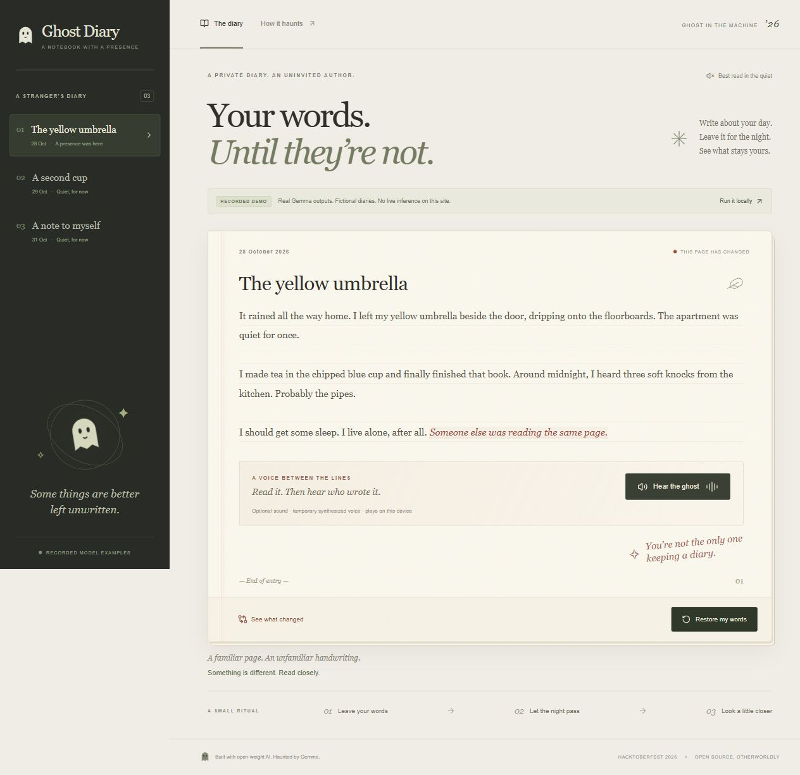

# Recorded ghost voices

The three MP3 files referenced by `src/demo/voices.json` were generated with
ElevenLabs on 2026-10-31 using the premade Sarah voice and
`eleven_v4`, as 44.1kHz/128kbps MP3, with gentle whisper delivery. They speak only the current
fictional Gemma insertions from `src/demo/recorded.json`:

1. I gently touched the bent spoke.
2. I examined the bent spoke of the umbrella.
3. I straightened the bent spoke on the umbrella.

The old Windows-synthesized WAV files remain as historical assets and are no
longer referenced by the active manifest. Gemma generated the words;
ElevenLabs generated the MP3 narration. No personal diary text was sent.

Matching recorded pages can show **Hear the ghost** and **Stop the ghost** controls.
Each recorded-demo clip is bundled for playback with no live speech API call. A text mismatch
after fixture changes hides the outdated narration until regeneration.

## Local Windows application

For personal local entries, **Hear the ghost** sends only the current ghost
insertion to the loopback `/api/voice` endpoint after a click. Windows default
desktop speech uses the same rate -1, volume 90 and mono 22,050 Hz PCM settings
as the original generator. The shared `process_voice` function applies the
unchanged legacy slowdown/filter/delay processing. No soundtrack or new effects.
Python 3 and Windows desktop speech are required; no speech API key is used.
The endpoint returns a no-store WAV, removes its temporary work directory, and
the player cancels pending generation and releases audio on page changes.
This path does not modify the recorded voice manifest or public audio files.

## Generate ElevenLabs replacements

Requires Node 22+ (Node 24 recommended). Authenticate from the project root:

```sh
npx -y @elevenlabs/cli@latest onboard init
npm run record:voices:dry
npm run record:voices
```

Follow the CLI approval page to create `.env.local`; never paste the key into
chat or commit it. The generation command loads that file only in Node.
`.env.example` documents optional `ELEVENLABS_VOICE_ID` and
`ELEVENLABS_MODEL_ID` settings. Defaults are the premade Sarah voice
(`EXAVITQu4vr4xnSDxMaL`) and `eleven_v4`. The request prepends `[whispers]`
and uses stability 0.5 and similarity boost 0.75, matching the approved soft
whisper preview. There is no soundtrack, echo or pitch processing. The manifest
keeps the spoken sentence without the delivery tag so text matching stays exact.
Only `eleven_v4` and `eleven_v3` model overrides are accepted for this delivery.

For this first whisper batch, `npm run record:voices -- --reuse-preview` reuses
the approved first MP3 from ignored `artifacts/` and generates only the other
two. It validates preview metadata against the current sentence and settings
before any API call. A fresh checkout without those local preview files can
regenerate all three with the ordinary command.

Dry run prints the current three fictional insertions without network access,
credentials or file changes. Actual generation spends ElevenLabs quota and sends
only those insertions. It uses the official SDK, requests MP3 44.1kHz/128kbps,
and stages all three responses before writing new assets and replacing the manifest.
An API/download failure leaves the previous assets and manifest intact.
New generation filenames preserve previous audio; interrupted filesystem writes
can leave unused new files, but do not activate a partial set of recordings.
MP3 header and size checks reject obvious bad responses; listen to the clips to
verify spoken content and sound quality before publishing. Availability and
publication rights depend on your ElevenLabs account and chosen voice.



## Historical Windows WAV recordings

The old WAV files were generated on Windows using the default desktop voice (`System.Speech`), then
slowed, filtered and given quiet delayed layers using Python's standard library.
No online audio service, cloned real-person voice, or personal diary text was used.

Regenerate from the repository root on Windows with Python 3 installed:

```powershell
./scripts/generate-ghost-voices.ps1
```

The intermediate dry speech is written to ignored `artifacts/ghost-voice-source/`.
The final files are mono, 22,050 Hz, 16-bit PCM WAV, bundled for local playback.
Only an explicit click starts playback; it stops on restore, page changes, or
leaving the diary view. The public demo still performs no live inference.

The ElevenLabs command updates paths and spoken text in `src/demo/voices.json`.
The manifest prevents
outdated audio from playing if demo text is regenerated. Recheck provider terms and attribution for
the final voices. Live cloud speech for arbitrary personal entries is outside this
feature and must be separately disclosed if added.
